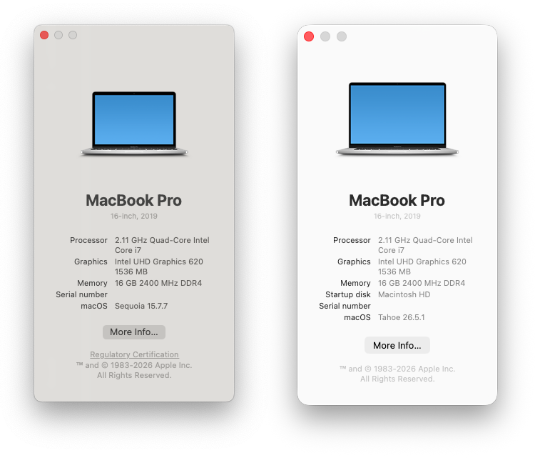
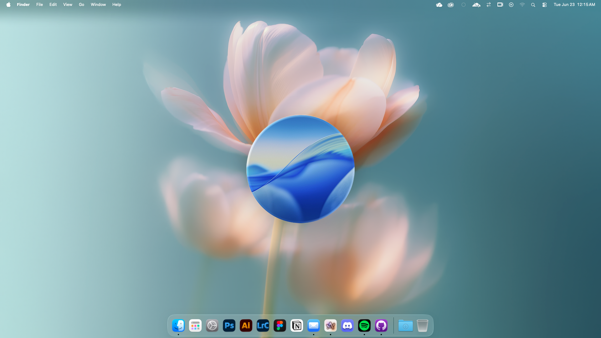
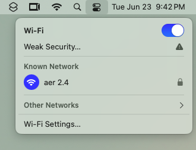
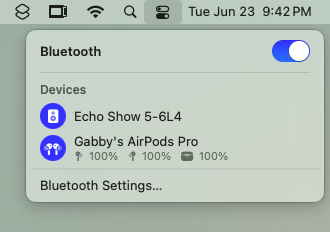

# Hackintosh ThinkPad T480s (Aercintosh)
**OpenCore Sequoia & Tahoe EFIs for Lenovo ThinkPad T480s (i7-8650U, Intel UHD 620)**  
Hackintosh build by [aerhazu](https://github.com/aerhazu). Credits to [felikafelix](https://github.com/felikafelix/Hackintosh-Thinkpad-T480s)s' build.

---

</a>

---

> [!NOTE]
> This EFI is a quick-start baseline for the Lenovo ThinkPad T480s (i7-8650U, Intel UHD 620), built from real Hackintosh experience to reduce setup time. Contents on this repo are self-opinionated as based on my own experience as a T480s owner.
>
> 🚨 **Please Note:**
> - Always review and generate your own serial numbers (SystemSerialNumber, MLB, UUID) before signing into Apple ID to avoid potential service locks.

> [!WARNING]
> While this EFI significantly reduces setup time, the Hackintosh journey still requires:
> - Understanding basic concepts from the [Dortania Guide](https://dortania.github.io/OpenCore-Install-Guide/)
> - Testing and troubleshooting during the installation process
> - Patience and persistence in resolving any issues that arise
>
> My EFI does not guarantee a successful installation in the first attempt, but it should help you get started.

---

## 📀 Select your macOS Guide
Select your desired macOS version below to see their guide.

### 1. [Sequoia](https://github.com/aerhazu/Hackintosh-ThinkPad-T480s/Docs/Sequoia-Guide.md) (15.7.x)
SMBIOS: `MacBookPro16,3`
Most performant & efficient macOS for Hackintosh systems. Highly recommended as a daily driver. Mature OpenCore integration with long-term community support.

### 2. [Tahoe](https://github.com/aerhazu/Hackintosh-ThinkPad-T480s/Docs/Tahoe-Guide.md) (26.5.x)
SMBIOS: `MacBookPro16,4`
[Last](https://www.reddit.com/r/hackintosh/comments/1l7dc62/next_stop_macos_26_tahoe/) & latest macOS available for Hackintosh systems. Recommended for users with a stable Sequoia build. Upgrade only if required by your workflow or if you intend to maintain a current EFI or you simply just want to.

---

## 💻 Device Specification

Click to see more

| Component | Details |
|----------:|:--------|
| **Model** | Lenovo ThinkPad T480s |
| **CPU** | Intel Core i7-8650U (2.11GHz, Turbo 4.2GHz) |
| **iGPU** | Intel UHD Graphics 620 |
| **RAM** | 2×8GB DDR4 2400MHz |
| **SSD** | GUDGA NE-512 M.2 2242 512GB |
| **Display** | IPS 14" FHD 1920×1080 & Xiaomi A24i 2026 (External) |
| **Audio** | Realtek ALC257 |
| **Battery** | No internal battery |
| **Ethernet** | Intel I219-LM4 |
| **WiFi/BT** | Intel Wireless-AC 8265/8275 |
| **Camera** | 720p HD |
| **Trackpad** | Synaptics Precision (PS2/SMBus) |

---

## 🪛 BIOS Settings

Click to see more

| Menu Path |                                                    Setting |
|:----------|-----------------------------------------------------------:|
| Config > USB > Always On USB |                                               **Disabled** |
| Config > Keyboard/Mouse > Trackpoint |                                       **Enabled/Disabled** |
| Config > Keyboard/Mouse > Trackpad |                                                **Enabled** |
| Config > Keyboard/Mouse > Fn and Ctrl Key swap |                                               **Disabled** |
| Config > Keyboard/Mouse > Fn Sticky Key |                                               **Disabled** |
| Config > Keyboard/Mouse > F1-F12 as Primary Function |                                               **Disabled** |
| Config > Display > Boot Display Device |                                           **Thinkpad LCD** |
| Config > Display > Shared Display Priority |                                             **USB Type-C** |
| Config > Display > Total Graphics Memory |                                                  **512MB** |
| Config > Power > Intel SpeedStep Technology |                                                **Enabled** |
| Config > CPU > Intel Hyper-Threading Technology |                                                **Enabled** |
| Config > Thunderbolt 3 > Thunderbolt BIOS Assist Mode |                                               **Disabled** |
| Config > Thunderbolt 3 > Security Level |                                            **No Security** |
| Config > Thunderbolt 3 > Wake by Thunderbolt 3 |                                                **Enabled** |
| Config > Thunderbolt 3 > Support in Pre Boot Environment |                                                **Enabled** |
| Security > Security Chip | **Disabled** *(Enable if dualbooting with Windows* |
| Security > Memory Protection > Execution Prevention |                                                **Enabled** |
| Security > Virtualization > Intel VT |                                                **Enabled** |
| Security > Virtualization > Intel VT-d |                                                **Enabled** |
| Security > I/O Port Access > Fingerprint Reader | **Disabled** *(Enable if dualbooting with Windows* |
| Security > Secure Boot |                                               **Disabled** |
| Security > Intel SGX |                                    **Software Controlled** |
| Security > Device Guard |                                               **Disabled** |
| Boot > UEFI/Legacy Boot |                                                   **Both** |
| Boot > UEFI/Legacy Boot Priority |                                           **Legacy First** |
| Boot > CSM Support |                                                    **Yes** |

---

## 📊 Status

<b>✅ Working</b>

| Feature | Notes                                    |
|---------|------------------------------------------|
| QE/CI & Hardware Acceleration | IQSV fully supported                     |
| Battery Management | Accurate percentage                      |
| CPU Power Management | Performance/Balance optimized            |
| USB-A & USB-C | Including power delivery                 |
| HDMI Output | Video & audio                            |
| Audio | Speaker, internal mic, 3.5mm jack        |
| WiFi 5GHz & 2.4GHz | Supported with Airdrop, Continuity, etc. |
| Bluetooth | Fully functional                         |
| Ethernet | Intel I219-LM                            |
| Trackpad & Trackpoint | Full gesture support                     |
| Touchscreen | Same as Trackpad, multi-gesture support  |
| Keyboard & Backlight | All keys working                         |
| Internal Webcam | 720p HD                                  |
| Sleep/Wake | Stable                                   |
| ThinkPad Fn Keys | F1-F12 via YogaSMC                       |
| iServices | iMessage, FaceTime, App Store, Find My   |
| Apple Music | Lossless/Hi-Res supported                |
| Airdrop | Send to iPhone only                      |
| Continuity/Handoff | Universal Clipboard, etc.                |
| iPhone Camera | USB cable                                |
| Android USB Tethering | HoRNDIS included                         |

<b>❌ Not Working</b>

| Feature | Reason |
|---------|--------|
| Safari DRM / Apple TV+ | Requires dGPU (workaround: Chrome/Firefox with Widevine) |
| Fingerprint Reader | No macOS driver |
| Airdrop Receiver | Intel WiFi limitation |
| iPhone Camera (Wireless) | Requires native AirDrop |

<b>🔍 Not Tested</b>

- Thunderbolt 3 (no device to test)
- Card Reader (my T480s card reader is broken)
- WWAN (no card installed)
- Touchscreen
- USB-C to Display Port/HDMI

<b>🐛 Known Issues</b>

**Color Banding**
-  Inaccurate color gradients in subtle shades (skies, dark scenes, UI gradients). This is a T480s stock panel limitation. Workaround by spoofing to Skylake platform-id works only on Monterey and older.

**ELAN Microelectronics USB Touchscreen Variant Issue**
- For ELAN Microelectronics USB Touchscreen variant on Tahoe, the touchscreen works but causes issues with wake from sleep, restart, and shutdown.

**Thunderbolt BIOS Assist Mode / TB3 hotplug**
- Disable Thunderbolt BIOS Assist Mode for reliable TB3 hotplug, though this comes with a higher [battery drain](https://github.com/tylernguyen/x1c6-hackintosh/issues/28#issuecomment-665806491). Keeping it enabled causes hotplug to fail or work inconsistently.

---

## 📸 Screenshots

<b>Click to expand gallery</b>

### Desktop

### Wifi

### Bluetooth

---

## 🙏 Credits & Acknowledgements

**Credits:**
- [@felikafelix](https://github.com/felikafelix/) - General setup and Sequoia & Tahoe EFI starting points.

**Projects & Tools:**
| Project | Maintainer |
|---------|------------|
| [OpenCore](https://github.com/acidanthera/OpenCorePkg), [Lilu](https://github.com/acidanthera/Lilu), [AppleALC](https://github.com/acidanthera/AppleALC), [WhateverGreen](https://github.com/acidanthera/WhateverGreen) | [Acidanthera](https://github.com/acidanthera) |
| [itlwm](https://github.com/OpenIntelWireless/itlwm), [HeliPort](https://github.com/OpenIntelWireless/HeliPort), [IntelBluetoothFirmware](https://github.com/OpenIntelWireless/IntelBluetoothFirmware) | [OpenIntelWireless](https://github.com/OpenIntelWireless) |
| [OpenCore Legacy Patcher](https://github.com/dortania/OpenCore-Legacy-Patcher) | [Dortania](https://github.com/dortania) |
| [OCLP-Mod](https://github.com/laobamac/OCLP-Mod) (Tahoe) | [laobamac](https://github.com/laobamac) |
| [VoltageShift](https://github.com/sicreative/VoltageShift) | [sicreative](https://github.com/sicreative) |
| [YogaSMC](https://github.com/zhen-zen/YogaSMC) | [zhen-zen](https://github.com/zhen-zen) |
| [ProperTree](https://github.com/corpnewt/ProperTree), [GenSMBIOS](https://github.com/corpnewt/GenSMBIOS), [CPUFriendFriend](https://github.com/corpnewt/CPUFriendFriend) | [corpnewt](https://github.com/corpnewt) |
| [Hackintool](https://github.com/benbaker76/Hackintool) | [benbaker76](https://github.com/benbaker76) |
| [BetterDisplay](https://github.com/waydabber/BetterDisplay) | [waydabber](https://github.com/waydabber) |
| [MyKextInstaller](https://github.com/Mirone/MyKextInstaller) | [Mirone](https://github.com/Mirone) |
| [HiDPI](https://github.com/xzhih/one-key-hidpi) | [xzhih](https://github.com/xzhih) |
| [HoRNDIS](https://github.com/TomHeaven/HoRNDIS) | [TomHeaven](https://github.com/TomHeaven) |
| [OCAuxiliaryTools](https://github.com/ic005k/OCAuxiliaryTools) | [ic005k](https://github.com/ic005k) |

---

## 📜 License

This repository is licensed under the [MIT License](./LICENSE)

OpenCore is licensed under the [BSD 3-Clause License](https://github.com/acidanthera/OpenCorePkg/blob/master/LICENSE.txt)
testt